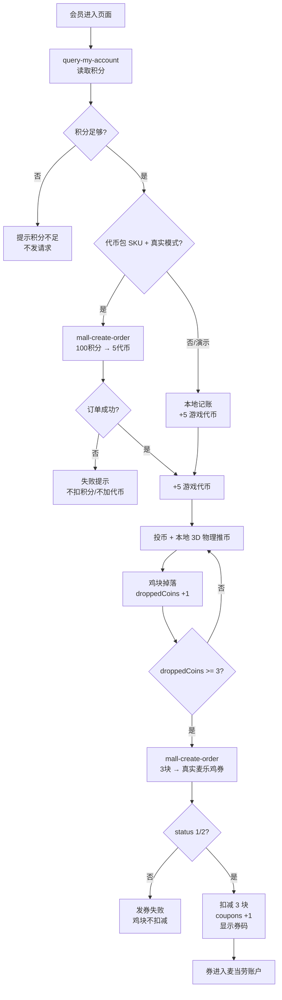

# MCP 集成说明 · 麦乐鸡块推币机

本文说明本参赛项目实际使用的麦当劳中国 MCP Server、Tool、调用流程、代码位置、异常处理与业务价值。

> **前置声明**
>
> `100 积分 → 5 枚游戏代币`、`3 个掉落鸡块 → 1 张麦乐鸡券`、整盒大奖概率与保底，都是本项目**自行设计的游戏规则**，不是麦当劳官方积分规则或官方活动商品。官方积分商城不保证存在“虚拟代币”或“3 块换券”商品。
>
> 项目提供两种显式模式：
>
> - **演示模式**：`npm run dev:mock`，顶部显示“演示模式 · 本地模拟 MCP”，不请求真实账户、不扣真实积分、不发真实券。
> - **真实模式**：`.env.local` 设置 `VITE_MCD_MOCK=0`，填写服务端 `MCD_MCP_TOKEN` 和真实 SKU。无 Token/SKU 时明确报错，不伪造成功。

---

## 1. Server 与安全配置

| 项目 | 值 |
|---|---|
| Server | 麦当劳中国 MCP |
| Endpoint | `https://mcp.mcd.cn` |
| Transport | Streamable HTTP / JSON-RPC 2.0 |
| 协议版本 | `2025-06-18` |
| 客户端 | `src/services/mcp.ts`，原生 `fetch` |
| 代理 | `vite.config.js`：浏览器 `/api/mcp` → `https://mcp.mcd.cn` |
| 前端凭证 | 无。Token 不进入浏览器 bundle |

### Token 如何注入

```text
浏览器  →  POST /api/mcp  →  Vite/Node 代理  →  https://mcp.mcd.cn
                              Authorization: Bearer ${MCD_MCP_TOKEN}
```

- `MCD_MCP_TOKEN` **没有 `VITE_` 前缀**，只由 Node 进程的 `.env.local` 读取。
- 浏览器只访问同源 `/api/mcp`，不读取 Token。
- 生产环境必须部署等价的 BFF / Serverless Function；静态 `dist` 本身无法安全转发 Token。
- `.env`、`.env.local` 已被 `.gitignore` 忽略；仓库只保留空模板 `.env.example`。
- `mcp-config.example.json` 只使用 `${MCD_MCP_TOKEN}` 占位符。

---

## 2. 实际使用的 MCP Tool

运行时只使用两个 Tool：

| # | Tool | 用途 | 代码位置 | 真实扣积分/发券 |
|---|---|---|---|---|
| 1 | `query-my-account` | 读取会员积分 | `src/services/mcp.ts` → `getPoints()` | 否，只读 |
| 2 | `mall-create-order` | 代币包订单 / 麦乐鸡券订单 | `src/services/mcp.ts` → `buyCoins()` / `exchangeCoupon()` | 真实模式下是 |

`mall-points-products` / `mall-product-detail` 不参与游戏运行时主流程，只用于开发期查询商城商品、确认可兑换商品。为避免人工核对出错，仓库提供只读预检脚本 `scripts/check-sku.mjs`（`npm run check:sku`），校验 `.env.local` 中配置的 SKU 当前是否真能兑换。

真机返回暴露了两个必须处理的事实：

- **`status = 2`（上架）不代表当前可兑换**。返回中长期存在 `status = 2` 但 `downTime` 已过期的历史商品，必须以 `upTime <= now <= downTime` 二次过滤。
- **唯一标识是商品级 `spuId`，不是 `skuId`**。`mall-create-order` 的入参字段名与本字段的对应关系需以服务端 `tools/list` 的 schema 为准，不可直接假设二者同名。

### 2.1 `query-my-account`

**触发**

- 页面启动：`src/main.js` → `store.refreshMemberPoints()`
- 每次兑币前重新校准积分
- 顶部会员积分卡展示

**入参**

```json
{}
```

**归一化**

`src/services/mcp.ts` 的 `findPoints()` 会递归查找 `points / availablePoints / availablePoint / currentPoints / memberPoints / balance / totalPoints` 等字段，兼容不同版本的账户返回结构。

### 2.2 `mall-create-order`

**代币包**

```json
{
  "skuId": 123456,
  "count": 1
}
```

- 仅在真实模式且配置 `VITE_MCD_COIN_SKU_ID` 时调用。
- 只有 MCP 返回成功后才增加游戏代币；演示模式使用本地记账。

**麦乐鸡券**

```json
{
  "skuId": 654321,
  "count": 1
}
```

- 仅在真实模式且配置 `VITE_MCD_COUPON_SKU_ID` 时调用。
- 只有订单 `status` 为成功（`1` 或 `2`）后才扣减 3 个本地鸡块并保存券码/订单号。
- 每次点击只发一单；不在一次调用中在前端批量伪造多张券。
- 返回的券码兼容扁平的 `couponCodes` 以及 `coupons[].couponCodes` 结构。

---

## 3. 积分流转业务流程图



### 真实调用与演示调用

| 阶段 | 真实模式 | 演示模式 |
|---|---|---|
| 查积分 | 真实 `query-my-account` | mock 账户 |
| 100 积分兑 5 代币 | 配置代币包 SKU 后真实 `mall-create-order` | 本地记账 |
| 投币推币 | 本地物理，不调用 MCP | 同左 |
| 3 块换券 | 配置真实券 SKU 后真实 `mall-create-order` | mock 券，不发真实券 |
| UI 标识 | 已连接麦当劳 MCP | 演示模式 · 本地模拟 MCP |

> **真实调用不是口头说法**：非 mock 模式下，客户端完成 `initialize → notifications/initialized → tools/call`，所有请求经 `/api/mcp` 代理携带服务端 Token；`mall-create-order` 返回成功后才更新前端资源。浏览器 Network 可以看到 `/api/mcp` 的 JSON-RPC 请求，页面左下角 MCP 调用流水也会标记 `query-my-account` / `mall-create-order`。

---

## 4. 业务价值

- **盘活沉睡积分**：把浏览式兑换变成 30 秒可玩的推币体验，提升打开与停留。
- **确定性权益**：在自定义规则下，3 块鸡块固定对应 1 张券；随机只影响过程表现。
- **成本可核算**：真实模式下以 SKU、积分与订单为准，运营可计算奖品预算。
- **可复用**：更换 SKU 与视觉即可复用为其他积分权益互动。
- **可审计**：MCP 请求与结果有调用流水，能追踪“积分 → 订单 → 券”的链路。

---

## 5. 异常与一致性

| 场景 | 处理 |
|---|---|
| 未配置 Token | 真实模式明确报错，不伪造成功 |
| 网络/CORS | 开发用 Vite 代理；生产用 BFF |
| 订单失败/`status=0` | 不扣积分、不加代币/券，允许重试 |
| 会话失效 | 清理 session，下次重新 initialize |
| 写操作超时 | 不自动重试，避免重复扣分/发券 |
| 商品字段变化 | `findPoints` / 券码解析做多结构兼容 |

前端状态只用于展示与游戏过程；真实扣分和发券必须以 MCP 订单返回为准。

---

## 6. 配置样例

仓库内的 [`mcp-config.example.json`](./mcp-config.example.json) 只包含环境变量占位符：

```json
{
  "mcpServers": {
    "mcd-mcp": {
      "type": "streamablehttp",
      "url": "https://mcp.mcd.cn",
      "headers": {
        "Authorization": "Bearer ${MCD_MCP_TOKEN}"
      }
    }
  }
}
```

应用侧环境变量见 [`.env.example`](./.env.example)；真实 Token 只写入本地 `.env.local`。

---

## 7. 验证状态

- `npm run build` 通过。
- Mock 模式 E2E 全流程通过；页面无 JS/资源错误，移动端无横向溢出。
- **只读链路已用真实 MCP Token 与真实会员账户实机验证通过**：`query-my-account` 与 `mall-points-products` 均返回真实业务数据，可复现。调用时间、traceId 与脱敏返回见 [`docs/MCP_VERIFICATION.md`](./docs/MCP_VERIFICATION.md)。
- **写操作（`mall-create-order` 扣积分/发券）未实机执行**：公开积分商城不存在本项目的「代币包」与「麦乐鸡券」对应 SKU，且验收账户积分低于自定义门槛。真实模式在缺少 SKU 时会明确报错，不伪造成功。
- 真机返回的两处字段差异已记录：`mall-points-products` 返回的是商品级 `spuId`（非 `skuId`），且 `status = 2` 不代表当前可兑换，须以 `upTime / downTime` 过滤。详见验收记录 §2.2。

> 结论：本项目真实调用了麦当劳 MCP 的只读能力；写操作链路的代码与异常处理完整，但受限于无匹配 SKU，需运营侧配置商品后方可端到端执行。

---

## 8. 参考

- [麦当劳中国 MCP 开放平台](https://open.mcd.cn/mcp)
- [麦当劳 MCP Server 使用指南](https://github.com/M-China/mcd-mcp-server)
- 提交前以麦当劳官方活动仓库中的规则和声明文件最新版本为准。
