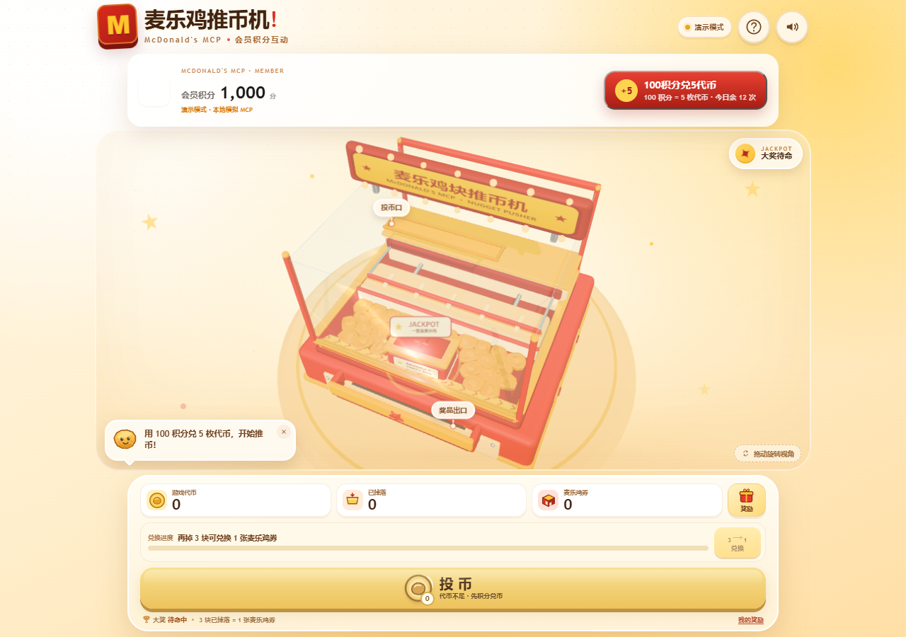

# 麦乐鸡块推币机 · NUGGET PUSHER × 麦当劳 MCP

一个原创低模 3D「推币机」参赛项目，把麦当劳中国 MCP 的会员积分接进游戏闭环：

**100 会员积分 → 5 枚游戏代币 → 投币推鸡块 → 攒 3 个掉落鸡块 → 1 张麦乐鸡券（真实模式）→ 推落整盒大奖**



> **重要声明（自定义玩法）**：`100 积分 → 5 枚代币`、`3 个掉落鸡块 → 1 张麦乐鸡券`、整盒大奖概率与保底均为本项目**自行设计的规则**，不是麦当劳官方积分规则、官方商品或官方活动。默认演示模式不请求真实账户、不扣真实积分、不发真实券；真实模式必须配置服务端 MCP Token 与真实券 SKU。正式活动上线前，规则、SKU、概率、奖品预算和宣传口径需品牌方/法务确认。
>
> **安全声明**：仓库不包含任何真实 Token。Token 只通过无 `VITE_` 前缀的 `MCD_MCP_TOKEN` 由 Vite/Node 代理读取，浏览器只访问同源 `/api/mcp`；`.env`、`.env.local` 已被 `.gitignore` 忽略。

## 项目与目标用户

**痛点**：会员积分往往只是账户里的数字。积分商城以“浏览 + 兑换”为主，缺少让用户愿意主动打开、停留、分享的情绪场景。

**做法**：把积分兑换做成一台推币机。代币从推板落到币床，推板往复推动，鸡块越过前缘后掉落；掉落的虚拟鸡块再成为兑换权益的进度。

- **麦当劳会员**：账户里有积分、对权益敏感、愿意为一张麦乐鸡券花 30 秒的年轻用户。
- **品牌运营**：会员日、程序员节、新品推广期的 H5 / 小程序内嵌 / 门店大屏互动。
- **价值**：把积分从“资产”变成短时、可感知的体验；兑换规则确定性可解释；视觉主体天然曝光麦乐鸡。

## 玩法闭环

1. **积分兑币**：`100 积分 = 5 枚游戏代币`。真实模式下调用 `mall-create-order`，成功后才增加代币；默认演示模式只做本地记账。
2. **投币**：每次消耗 1 枚代币，鸡块落到推板顶面并跟随推板移动。
3. **推落**：推板回撤时鸡块被后方挡板拦住，推板继续回撤后鸡块失去支撑落到币台；越过末端斜坡前缘才计入掉落。
4. **兑换**：`3 个已掉落鸡块 = 1 张麦乐鸡券`。真实模式下调用 `mall-create-order`，成功返回券码/订单后才扣掉落物，并提示“券已发至麦当劳账户”。
5. **大奖**：推落整盒麦乐鸡触发 JACKPOT，收下后 5 秒自动补货。
6. **记录**：奖励页保存积分兑币/兑换券记录、订单号和券码。

> 掉落不是“投一枚必掉一枚”：推板物理、随机助攻和斜坡共同决定掉落。MCP 写操作不自动重试，避免重复扣分/发券。

## 快速运行

要求 Node.js ≥ 20.19（Vite 8）。

```bash
npm install
npm run dev:mock
# 浏览器打开终端显示的地址（通常 http://127.0.0.1:5173）
```

`dev:mock` 是无 Token 的完整演示：顶部会显示“演示模式 · 本地模拟 MCP”，不会请求真实账户。

生产构建：

```bash
npm run build
npm run preview
```

## 真实 MCP 配置

复制模板并填写 **服务端** Token：

```bash
cp .env.example .env.local
# Windows PowerShell: Copy-Item .env.example .env.local
```

`.env.local`：

```dotenv
# 浏览器只访问同源代理
VITE_MCD_MCP_URL=/api/mcp
VITE_MCD_MOCK=0
VITE_MCD_COIN_SKU_ID=代币包对应的商城 skuId
VITE_MCD_COUPON_SKU_ID=麦乐鸡券对应的商城 skuId

# 仅 Vite/Node 代理读取，不会进入浏览器 bundle
MCD_MCP_ENDPOINT=https://mcp.mcd.cn
# 从 open.mcd.cn/mcp 控制台复制后填写；不要提交
MCD_MCP_TOKEN=
```

Token 获取：<https://open.mcd.cn/mcp>。启动 `npm run dev` 后，`vite.config.js` 会把 `/api/mcp` 转发到 `https://mcp.mcd.cn` 并注入 `Authorization` 头；顶部状态点变为“已连接麦当劳 MCP”。

`mall-create-order` 的运行时参数以服务端 `tools/list` 的 schema 为准；当前按社区文档发送 `{ skuId, count }`，如实际 schema 不同，可用 `VITE_MCD_COIN_ORDER_ARGS` / `VITE_MCD_COUPON_ORDER_ARGS` 覆盖。

### ⚠️ 真实发券的前提

1. **代币包**：麦当劳积分商城不保证存在“100 积分换 5 代币”的商品；没有真实 SKU 时，真实模式会明确报错，不会伪造扣分/到账。
2. **麦乐鸡券**：`3 块换 1 张券` 是项目自定义规则。真实发券需要一个真实券 SKU；如果券本身消耗积分，3 块掉落物只是游戏侧资格门槛，实际还会扣积分。若希望“只扣掉落物”，需要 0 积分券 SKU 或后端游戏侧结算。
3. **配置真实 SKU 前**，先跑 `npm run check:sku`（见下）确认真实可兑换。

### SKU 预检（只读，不产生订单）

```bash
npm run check:sku            # 读 .env.local 的 MCD_MCP_TOKEN，调 mall-points-products 校验已配置的 SKU
npm run check:sku -- --all   # 连已过期的商品一起列出
```

脚本做两件人工容易漏掉的事：

- **`status = 2`（上架）不代表当前可兑换**。真机返回里长期存在 `status = 2` 但 `downTime` 早已过去的商品，必须以 `upTime <= now <= downTime` 二次过滤，否则会把已下架商品配进 `.env.local`。
- **返回字段是商品级 `spuId`，不是 `skuId`**。直接抄 `skuId` 填 `.env` 会永远匹配不上，脚本会在匹配失败时明确提示这一点。

退出码 `0` 表示配置可用，`1` 表示不可用，`2` 表示环境/鉴权问题。无 Token 时可用 `--from-file tests/fixtures/mall-points-products.sample.json` 离线重放判定逻辑。

### 安全边界

- **Token 不进入浏览器 bundle**：`MCD_MCP_TOKEN` 没有 `VITE_` 前缀，只由 `vite.config.js` 的 Node 代理读取；浏览器只请求同源 `/api/mcp`。
- 生产环境必须把 Vite 代理替换为自建 BFF / Serverless Function，Token 只存在服务端；静态部署不能直接转发 Token。
- 仓库只保留空值 `.env.example`；`.env`、`.env.local` 已忽略。代码中没有真实 Token。
- 前端状态（积分/代币/掉落物）不可信；真实扣分与发券以 MCP 订单返回为准，正式活动必须由服务端核验。

## 音频

- 不包含 BGM，也没有任何外部音频文件。
- 投币、落板、兑换和大奖音效由 `src/audio.js` 使用 WebAudio 程序化合成，避免第三方素材授权问题。

## 验收与开发

```bash
npm run check:sku  # SKU 预检：校验 .env.local 配置的 SKU 当前是否真能兑换（只读）
npm run test:e2e   # 终端 1 先运行 npm run dev:mock
npm run sim        # 离线物理调参
```

E2E 使用 mock MCP 验证完整业务，覆盖购买、投币、掉落、兑换、奖励记录、大奖刷新、余额提示和移动端布局；页面无 JS/资源错误、移动端横向溢出 0px。

`?debug=1` 仅在开发模式暴露调试接口。

## 状态结构

`src/store.js` 采用自定义 Store + 订阅，核心字段：

```js
{
  memberPoints,    // 真实会员积分（启动时查询；前端展示缓存）
  virtualCoins,    // 游戏代币
  droppedCoins,    // 已掉落虚拟鸡块
  isLoading,       // MCP 请求锁
  pointsLoaded,    // 区分 0 分与未加载
  coupons,         // 已发放麦乐鸡券
  records: [{ type, coupons, orderId, code, status }],
}
```

`buyCoins()` / `exchange()` 先通过 `/api/mcp` 调用 MCP，成功后才变更本地余额；写操作不自动重试。

## 参赛提交文件

| 文件 | 说明 |
|---|---|
| `README.md` | 项目介绍、安装、使用方式、目标用户 |
| `CONTEST_DECLARATION.md` | 官方参赛声明，保持原文不改动 |
| `MCP_INTEGRATION.md` | 实际 MCP Server/Tool、调用流程、真实调用与边界 |
| `mcp-config.example.json` | 脱敏 MCP 配置，仅环境变量占位符 |
| `workbuddy.md` | WorkBuddy 开发上下文：MCP 真机验收、缺陷发现与预检工具补齐的过程记录 |
| `docs/MCP_VERIFICATION.md` | MCP 真机验收记录（traceId、脱敏返回、可复现步骤） |
| `src/` + `package.json` | 可运行源码 |

> `workbuddy.md` 申报 WorkBuddy 专项奖励时需要。本文档仅覆盖在 WorkBuddy 中完成的验收与工具补齐阶段，所含技术描述均对应仓库真实文件。

## 版权与免责声明

本页面的 3D 视觉、SVG 素材和交互为原创实现，不使用官方品牌 Logo、图片、字体或音频。页面不代表麦当劳官方活动；接入真实积分、券和门店核销前，请完成品牌授权、活动规则、隐私政策和法务审核。
